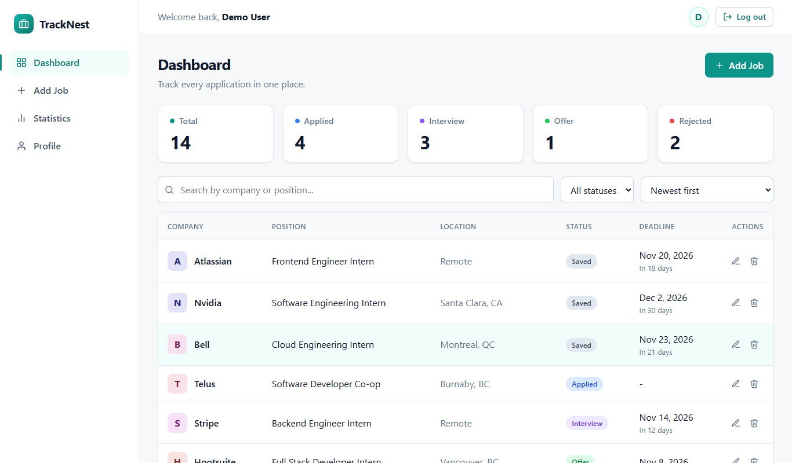
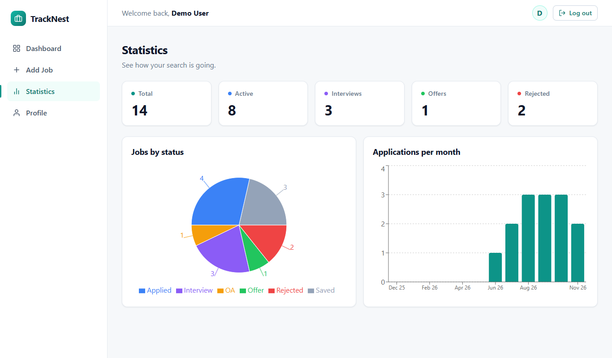
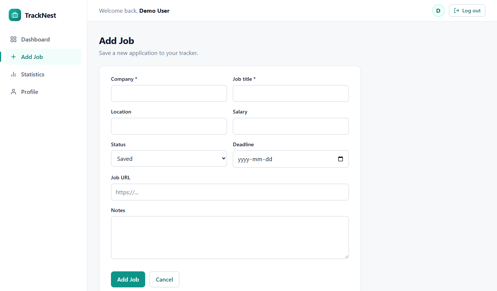
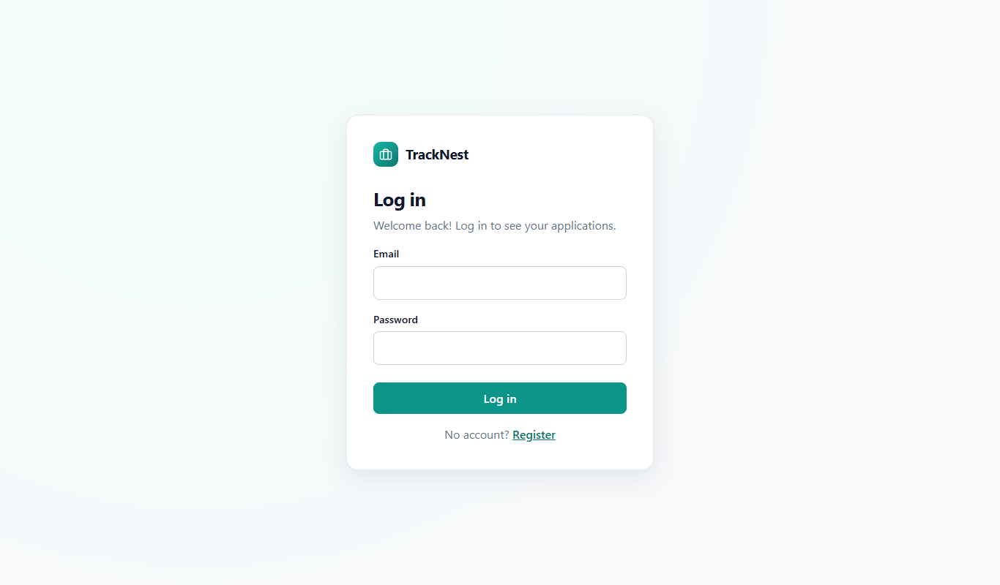
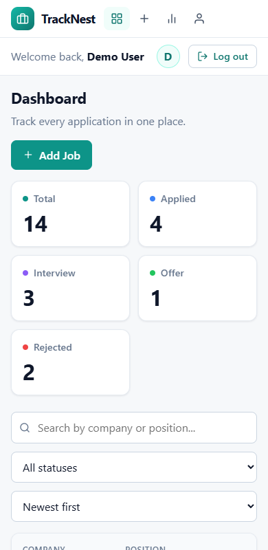

# TrackNest

A full-stack job application tracker. Save the jobs you apply to, move them through the hiring pipeline (Saved, Applied, OA, Interview, Offer, Rejected), and see how your search is going with charts.

Built as a portfolio project with React, Node/Express and PostgreSQL.

**Live demo (one click, no sign-up):** https://tracknest-flax.vercel.app/demo

Or open https://tracknest-flax.vercel.app and press **Try the demo account** on the login page. You can also log in manually with `demo@tracknest.dev` / `Demo1234!`.

The demo account is shared, so its name, email and password are read-only (you can still add, edit and delete jobs). Register your own account to try the profile page.

> The API runs on Render's free tier, so the first load after inactivity can take up to a minute to wake up.



## Features

- Register and log in (JWT authentication, passwords hashed with bcrypt)
- Add, edit and delete job applications (with a confirmation popup)
- Search by company or position, filter by status, sort, and paginate (all done by the server API)
- Deadline hints on each row ("In 3 days", "2 days overdue")
- Statistics page: summary cards, pie chart by status, bar chart of applications per month
- Profile page: change name, email and password
- Responsive layout for desktop, tablet and phone
- Input validation on both the client and the server
- Friendly error handling: 404 page, expired-session redirect, server and network error messages, retry buttons
- Loading spinners, skeleton rows and disabled buttons while saving

## Screenshots

| Statistics | Add job |
| --- | --- |
|  |  |

| Login | Phone |
| --- | --- |
|  |  |

## Tech stack

| Part | Technology |
| --- | --- |
| Frontend | React (Vite), React Router, Axios, Recharts, plain CSS |
| Backend | Node.js, Express 5, JSON Web Tokens, bcryptjs |
| Database | PostgreSQL (hosted on Neon) |
| Hosting | Vercel (client), Render (server), Neon (database) |

## Project structure

```
TrackNest/
  client/                 React app
    src/
      api/axios.js        Axios instance (adds the token, handles 401)
      components/         Reusable pieces (Layout, JobForm, Spinner, ...)
      context/            Login state (AuthContext, useAuth)
      pages/              One file per page
      utils/              Constants, date formatting, error messages
      index.css           All styles; the teal colors are variables at the top
  server/                 Express API
    config/db.js          Database connection
    controllers/          Request handling and validation
    middleware/           Login check (protect) and error handlers
    models/               SQL queries
    routes/               URL -> controller wiring
    scripts/seed.js       Creates the demo account
    utils/validators.js   Shared validation helpers
    schema.sql            Table definitions
  docs/                   Screenshots and the testing checklist
```

## Run it locally

You need Node 20+ and a PostgreSQL database (a free Neon database works).

### 1. Database

Run [server/schema.sql](server/schema.sql) in your database to create the `users` and `jobs` tables.

### 2. Server

```powershell
cd server
npm install
copy .env.example .env      # then fill in the values
npm run dev                 # http://localhost:5000
```

`server/.env`:

| Variable | Meaning |
| --- | --- |
| `PORT` | Port the server listens on (default 5000) |
| `DATABASE_URL` | PostgreSQL connection string |
| `JWT_SECRET` | Long random string used to sign login tokens |
| `CLIENT_URL` | Allowed frontend origin(s), comma-separated, no trailing slash |

### 3. Client

```powershell
cd client
npm install
copy .env.example .env      # VITE_API_URL=http://localhost:5000/api
npm run dev                 # http://localhost:5173
```

### 4. Demo account (optional)

```powershell
cd server
npm run seed
```

Creates `demo@tracknest.dev` (password `Demo1234!`) with 14 sample jobs spread over the last 6 months so the charts look real. It does nothing if that user already exists and never touches any other user.

Visitors can add, edit and delete jobs on the demo account. To put it back to a clean state:

```powershell
npm run seed -- --reset
```

This deletes only the demo user's jobs, creates the 14 sample jobs again with fresh dates, and restores the demo name and password.

### Useful scripts

| Where | Command | What it does |
| --- | --- | --- |
| client | `npm run dev` | Start the dev server |
| client | `npm run lint` | Check the code with ESLint |
| client | `npm run build` | Production build into `client/dist` |
| server | `npm run dev` | Start the API with auto-restart (nodemon) |
| server | `npm start` | Start the API |
| server | `npm run seed` | Create the demo account |
| server | `npm run seed -- --reset` | Reset the demo account's jobs to the 14 samples |

## API documentation

Base URL: `http://localhost:5000/api`. All bodies are JSON.
Routes marked **Auth** need the header `Authorization: Bearer <token>` (the token comes from register/login).

### Error format

Every error is JSON with a `message`:

```json
{ "message": "Company is required" }
```

| Status | Meaning |
| --- | --- |
| 400 | Invalid input (the message says what is wrong) |
| 401 | Missing/expired token (`code: "AUTH_REQUIRED"`), wrong password |
| 403 | The demo account cannot change its profile or password |
| 404 | Job/user/route not found |
| 409 | Email already registered |
| 413 | Request body too large |
| 500 | Unexpected server error (details are only in the server log) |

### Auth

| Method | Route | Auth | Body | Success response |
| --- | --- | --- | --- | --- |
| POST | `/auth/register` | no | `{ name, email, password }` | `201 { user, token }` |
| POST | `/auth/login` | no | `{ email, password }` | `200 { user, token }` |
| GET | `/auth/me` | yes | - | `200 { user }` |
| PUT | `/auth/profile` | yes | `{ name, email, currentPassword }` (password only needed when the email changes) | `200 { user }` |
| PUT | `/auth/password` | yes | `{ currentPassword, newPassword }` | `200 { message }` |

`PUT /auth/profile` and `PUT /auth/password` return `403` for the shared demo account.

Rules: name up to 100 characters, valid email up to 255 characters, password 8 to 72 characters.

### Jobs (all **Auth**; a user only ever sees their own jobs)

| Method | Route | Description |
| --- | --- | --- |
| GET | `/jobs` | One page of jobs (see query params below) |
| GET | `/jobs/stats` | `{ total, byStatus, byMonth }` for the cards and charts |
| GET | `/jobs/:id` | One job: `{ job }` |
| POST | `/jobs` | Create a job: `201 { job }` |
| PUT | `/jobs/:id` | Replace a job's fields: `200 { job }` |
| DELETE | `/jobs/:id` | Delete a job: `200 { message }` |

**Query params for `GET /jobs`**

| Param | Values | Default |
| --- | --- | --- |
| `search` | text matched against company or position | none |
| `status` | `All`, `Saved`, `Applied`, `OA`, `Interview`, `Offer`, `Rejected` | `All` |
| `sortBy` | `company`, `deadline`, `created_at`, `status` | `created_at` |
| `order` | `asc`, `desc` | `desc` |
| `page` | 1, 2, 3, ... | 1 |
| `limit` | 1 to 50 | 10 |

Response:

```json
{
  "jobs": [ { "id": 7, "company": "Stripe", "job_title": "Backend Engineer Intern", "status": "Interview", "...": "..." } ],
  "pagination": { "page": 1, "limit": 10, "total": 14, "totalPages": 2 }
}
```

**Job body (POST / PUT)**

| Field | Required | Rules |
| --- | --- | --- |
| `company` | yes | text, up to 150 characters |
| `job_title` | yes | text, up to 150 characters |
| `status` | no | one of the six statuses (default `Saved`) |
| `location` | no | up to 150 characters |
| `salary` | no | up to 50 characters |
| `deadline` | no | a real date, `YYYY-MM-DD` |
| `job_url` | no | must start with `http://` or `https://` |
| `notes` | no | up to 5000 characters |

## How errors are handled

- **Server:** every controller validates its input and returns a 4xx message; unknown routes return a JSON 404; a final error handler turns unexpected problems into a safe `500` (and invalid JSON into a `400`).
- **Client:** one Axios interceptor catches an expired login (401) and redirects to the login page with a message. `getErrorMessage()` turns network, timeout, 5xx and 4xx errors into readable sentences. An error boundary catches crashes while rendering, and unknown URLs show a 404 page inside the app.

## Testing

A manual testing checklist is in [docs/TESTING.md](docs/TESTING.md).

## Deployment

The client is deployed on Vercel, the server on Render and the database on Neon. Pushing to `main` redeploys both apps. Set `VITE_API_URL` on Vercel and `DATABASE_URL`, `JWT_SECRET` and `CLIENT_URL` on Render.
